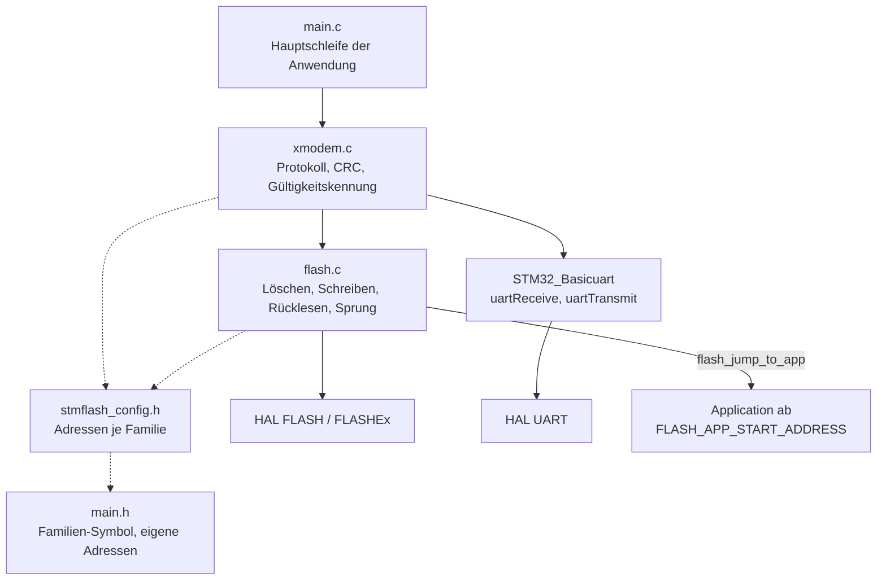
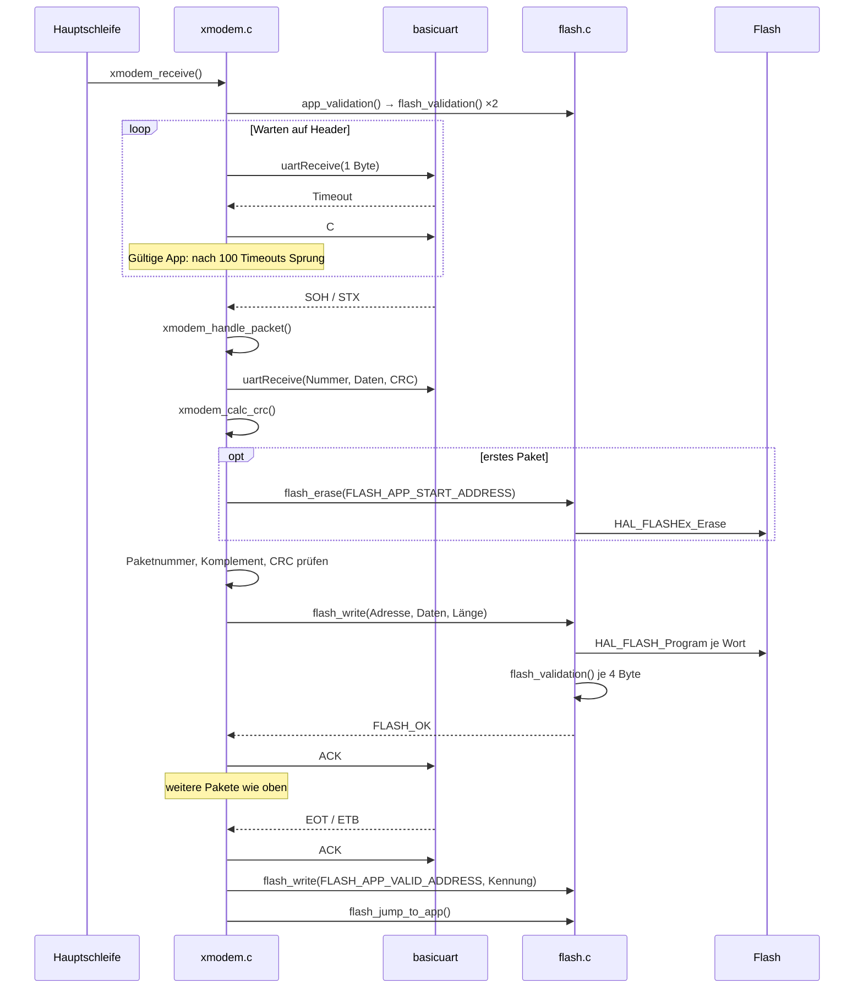
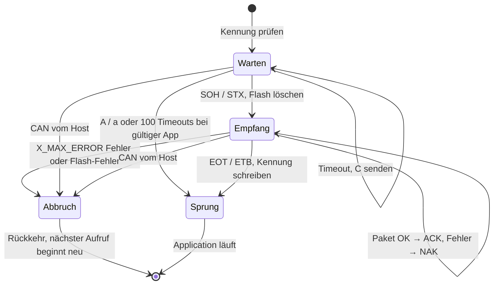

# Architektur STM32 Bootloader XModem

Der Bootloader besteht aus zwei Schichten: `xmodem.c` führt das Protokoll und
entscheidet, ob empfangen oder in die Application gesprungen wird, `flash.c` kapselt
Löschen, Schreiben, Prüfen und den Sprung je STM32-Familie. Alle Adressen kommen aus
`stmflash_config.h`. Es gibt keine Interrupts und keinen Puffer über ein Paket hinaus:
Jedes Paket wird blockierend empfangen, sofort geschrieben und zurückgelesen.

## Komponenten

| Modul | Datei(en) | Aufgabe |
|---|---|---|
| Protokoll | `xmodem.c`, `xmodem.h` | Hauptschleife `xmodem_receive()`, Paket empfangen und prüfen, Fehler zählen, Gültigkeitskennung lesen und schreiben |
| Flash | `flash.c`, `flash.h` | Page- bzw. Sector-Löschung, Schreiben in der Breite der Familie mit Rücklesen, Vergleich von 4 Byte, Sprung in die Application |
| Konfiguration | `stmflash_config.h` | Wählt `FLASH_PAGE` oder `FLASH_SECTOR`, Standardadressen und Sector-Tabellen je Familie; jeder Wert in `main.h` überschreibbar |
| UART | `basicuart.h` (extern) | Blockierendes Senden und Empfangen mit Timeout, siehe [README](README.md#abhängigkeiten) |

Die Familie wird zur Compile-Zeit über `STM32F1`, `STM32F7`, `STM32G0` oder `STM32H7`
aus `main.h` gewählt. Alle familienabhängigen Stellen sind `#if`-Zweige, es gibt keine
Laufzeitumschaltung.

## Datenfluss

Ablauf eines Uploads. Alles läuft in der Hauptschleife, die Aufrufe an `basicuart`
blockieren bis zum Empfang oder Timeout.

Zustände innerhalb von `xmodem_receive()`:

Fehler werden in `xmodem_status` und `flash_status` als Bitmaske gesammelt, damit ein
Paket mehrere Ursachen gleichzeitig melden kann. `xmodem_error_handler()` zählt nur
aufeinanderfolgende Fehler. Ein Flash-Fehler setzt den Zähler direkt auf `X_MAX_ERROR`,
weil eine Wiederholung des Pakets den Flash nicht repariert.

## Speicher und Ressourcen

Aufteilung des Flash mit den Standardwerten aus `stmflash_config.h`:

| Bereich | STM32F1 | STM32G0 | STM32F7 | STM32H7 |
|---|---|---|---|---|
| Bootloader | `0x08000000`–`0x08007FFF` | `0x08000000`–`0x08007FFF` | Sektor 0 | Sektor 0 |
| Gültigkeitskennung (8 Byte) | `0x08007FF8`, letzte Page des Bootloaders | `0x08007FF8`, letzte Page des Bootloaders | `0x0800FFF8`, Ende Sektor 1 | `0x080DFFE0`, Ende Sektor 6 |
| Application | ab `0x08008000` | ab `0x08008000` | Sektor 1 ab `0x08008000` | Sektor 1 ab `0x08020000` |
| Konfiguration der Application | `0x08038000`, im App-Bereich | `0x08018000`, im App-Bereich | `0x08010000`, Sektor 2 | `0x080DFF00`, Sektor 6 |
| Löschen beim Upload | alle Pages bis `FLASH_APP_END_ADDRESS` | alle Pages bis `FLASH_APP_END_ADDRESS` | nur Sektor 1 | nur Sektor 1 |

Die Gültigkeitskennung ist das feste Muster `app_valid_array` in `xmodem.c`. Sie liegt
außerhalb des Bereichs, den die Application belegt, und wird erst nach `EOT` geschrieben.
Ein abgebrochener oder unvollständiger Upload hinterlässt so keine Kennung, die zu einem
Sprung in eine halbe Application führt. Ob `flash_erase()` die Kennung mitlöscht, hängt
von der Familie ab (siehe Tabelle). Der Konfigurationsbereich wird vom Bootloader nicht
benutzt, er ist für die Application reserviert.

Schreibbreite je Familie, daraus ergibt sich der Teiler in `xmodem_handle_packet()`:

| Familie | HAL-Typ | Breite | Wörter je 128-Byte-Paket |
|---|---|---|---|
| STM32F1, STM32G0 | `FLASH_TYPEPROGRAM_DOUBLEWORD` | 8 Byte | 16 |
| STM32F7 | `FLASH_TYPEPROGRAM_WORD` | 4 Byte | 32 |
| STM32H7 | `FLASH_TYPEPROGRAM_FLASHWORD` | 32 Byte | 4 |

| Ressource | Verwendung |
|---|---|
| Stack | `xmodem_handle_packet()` legt 1028 Byte Empfangspuffer auf dem Stack an, der Stack des Bootloaders muss dafür reichen |
| Statische Daten | Paketnummer, aktuelle Schreibadresse, Merker für das erste Paket, Kennung und Löschmuster (je 8 Byte) |
| UART | eine Schnittstelle über `basicuart`, Baudrate und Timeout dort festgelegt; der Timeout bestimmt die Wartezeit vor dem automatischen Sprung |
| Flash | Bank 1, `HAL_FLASH_Unlock()` / `HAL_FLASH_Lock()` um jeden Lösch- und Schreibvorgang |

## Nebenläufigkeit

| Kontext | Was läuft dort | Gemeinsame Daten |
|---|---|---|
| Hauptschleife | der gesamte Bootloader: Empfang, CRC, Flash, Sprung | – |
| Interrupts | keine eigenen; HAL-Zeitbasis über SysTick für UART-Timeout und Flash-Wartezeiten | – |

Vor dem Sprung ruft `flash_jump_to_app()` `HAL_DeInit()` auf, setzt den Main Stack
Pointer aus dem ersten Wort der Vektortabelle der Application und springt an deren
Reset-Handler aus dem zweiten Wort. Die Vektortabelle verschiebt die Application selbst
(`VECT_TAB_OFFSET`, siehe [README](README.md#4-application-anpassen--vektortabelle)).

## Erweiterung

- **Neue STM32-Familie:** in `stmflash_config.h` `FLASH_PAGE` oder `FLASH_SECTOR` setzen,
  alle Standardadressen und bei Sektoren die Tabelle `ADDR_FLASH_SECTOR_n_BANK1` ergänzen.
  In `flash.c` die `#if`-Zweige in `flash_erase()` (Löschtyp, Page/Sector), `flash_write()`
  (Zusammensetzen des Worts, HAL-Typ, Rücklesen, Adressschritt) und bei Sektoren
  `GetSector()` ergänzen. In `xmodem.c` den Teiler in `xmodem_handle_packet()` und die
  Länge beim Schreiben der Kennung nach `EOT` anpassen. README-Tabellen im selben Commit
  nachziehen.
- **Neues Steuerbyte vom Host:** Define in `xmodem.h` anlegen und einen `case` im
  `switch (header)` von `xmodem_receive()` ergänzen. Das Byte darf nicht mit `SOH`,
  `STX`, `EOT`, `ETB` oder `CAN` kollidieren.
- **Andere Wartezeit vor dem Sprung:** Die Zahl 100 steht direkt in `xmodem_receive()`,
  die Dauer eines Versuchs ist der UART-Timeout in `basicuart`.
