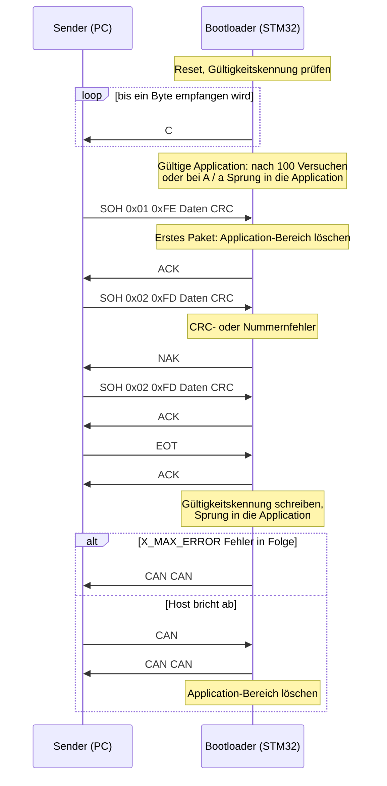

# STM32 Bootloader XModem

Ein in C implementierter UART-Bootloader für STM32-Mikrocontroller, der das
XModem-CRC-Protokoll zur Übertragung einer neuen Firmware verwendet. Mit einem
Terminal-Programm wie TeraTerm kann eine neue Application bequem über die
serielle Schnittstelle aufgespielt werden, ohne dass ein Programmer oder
Debugger angeschlossen sein muss.

Die Bibliothek basiert auf dem Projekt von [ferenc-nemeth/stm32-bootloader](https://github.com/ferenc-nemeth/stm32-bootloader)
und wurde für mehrere STM32-Serien und erweiterbare Flash-Konfiguration
weiterentwickelt.

## Beschreibung

Der Bootloader startet nach dem Reset und prüft, ob im Flash-Speicher bereits
eine gültige Application vorhanden ist. Wenn ja, wartet er 100 Empfangsversuche
lang auf einen Firmware-Upload und springt danach automatisch in die Application.
Die Dauer eines Versuchs ergibt sich aus dem UART-Timeout in `basicuart`. Wird
keine gültige Application gefunden, wartet der Bootloader dauerhaft auf einen
Upload.

Die Übertragung erfolgt über XModem mit 16-Bit-CRC-Prüfung. Der Empfang ist
empfängergesteuert: Der STM32 sendet zunächst ein `C` an den PC, worauf der
Sender mit dem ersten Paket antwortet. Jedes Paket wird geprüft, sofort in den
Flash geschrieben und mit ACK bestätigt oder bei Fehler mit NAK abgelehnt und
erneut angefordert. Nach dem letzten Paket setzt der Bootloader die
Gültigkeitskennung und springt in die Application.

## Funktionsumfang

- Empfang über XModem-CRC mit 128-Byte-Paketen (`SOH`) und 1024-Byte-Paketen (`STX`)
- CRC-16-Prüfung und Prüfung der Paketnummer, fehlerhafte Pakete werden mit `NAK` neu angefordert
- Abbruch mit `CAN` nach `X_MAX_ERROR` aufeinanderfolgenden Fehlern oder sofort bei einem Flash-Fehler
- Schreiben in den Flash mit Rücklesen und Vergleich jedes geschriebenen Worts
- Gültigkeitskennung der Application im Flash, wird nach erfolgreichem Upload gesetzt
- Automatischer Sprung in eine gültige Application, wenn kein Upload beginnt
- Sofortiger Sprung in eine gültige Application durch Senden von `A` oder `a`
- Löschen der Application, wenn der Host den Upload mit `CAN` abbricht
- Standardadressen je STM32-Familie, überschreibbar in `main.h`

## Dateien

| Datei               | Beschreibung                                                                     |
|---------------------|----------------------------------------------------------------------------------|
| `xmodem.h`          | Protokollkonstanten, Steuerbytes, `xmodem_status`-Enum, Funktionsdeklarationen   |
| `xmodem.c`          | XModem-Empfangslogik, CRC-Berechnung, Paketvalidierung, Application-Start        |
| `flash.h`           | Flash-API für Löschen und Schreiben                                              |
| `flash.c`           | Flash-Implementierung (Page/Sector je nach STM32-Familie)                        |
| `stmflash_config.h` | Flash-Adressen, Speichergröße und Sector-Mapping für alle unterstützten Familien |

## Konfigurationsparameter

Die Flash-Parameter werden in `stmflash_config.h` automatisch anhand des definierten
Mikrocontroller-Symbols (`STM32F1`, `STM32F7`, `STM32G0`, `STM32H7`) gesetzt.
Jeder Wert kann vor dem Einbinden der Bibliothek in `main.h` überschrieben werden.

| Parameter                  | STM32F1      | STM32F7      | STM32G0      | STM32H7      | Bedeutung                          |
|----------------------------|--------------|--------------|--------------|--------------|------------------------------------|
| `FLASH_APP_START_ADDRESS`  | `0x08008000` | `0x08008000` | `0x08008000` | `0x08020000` | Startadresse der Application       |
| `FLASH_APP_END_ADDRESS`    | `0x0803FFFF` | `0x081FFFFF` | `0x0801FFFF` | `0x080DFFFF` | Endadresse der Application         |
| `FLASH_APP_VALID_ADDRESS`  | `0x08007FF8` | `0x0800FFF8` | `0x08007FF8` | `0x080DFFE0` | Adresse der Gültigkeitskennung     |
| `FLASH_APP_CONFIG_ADDRESS` | `0x08038000` | `0x08010000` | `0x08018000` | `0x080DFF00` | Adresse des Konfigurationsbereichs |
| `FLASH_SIZE`               | 256 kB       | 128 kB       | 128 kB       | 128 kB       | Größe des Flash-Speichers          |

Beispiel für eigene Werte in `main.h`:

```c
#define FLASH_APP_START_ADDRESS   0x08008000   // Startadresse der Application
#define FLASH_APP_END_ADDRESS     0x0803FFFF   // Endadresse der Application
#define FLASH_APP_VALID_ADDRESS   0x08007FF8   // Adresse der Gueltigkeitskennung
#define FLASH_APP_CONFIG_ADDRESS  0x08038000   // Adresse des Konfigurationsbereichs
```

Weitere Parameter in `xmodem.h`, nur durch Ändern der Datei einstellbar:

| Parameter     | Standard | Bedeutung                                              |
|---------------|----------|--------------------------------------------------------|
| `X_MAX_ERROR` | `3`      | Aufeinanderfolgende Fehler bis zum Abbruch mit `CAN`   |

## XModem-Protokoll

### Ablauf



### Paketformat

| Header (Byte 1) | Paketnummer (Byte 2) | Komplement (Byte 3) | Daten                      | CRC-16          |
|-----------------|----------------------|---------------------|----------------------------|-----------------|
| `SOH`           | 1 Byte               | 1 Byte              | 128 Byte (Byte 4–131)      | Byte 132–133    |
| `STX`           | 1 Byte               | 1 Byte              | 1024 Byte (Byte 4–1027)    | Byte 1028–1029  |

- Byte 1 darf nur `SOH`, `STX`, `EOT`, `ETB`, `CAN`, `A` oder `a` sein, andernfalls
liegt ein Fehler vor.
- Bytes 2 und 3 bilden eine Paketnummer mit Prüfsumme: die Summe beider Bytes
ergibt immer `0xFF`.
- Die Paketnummer beginnt bei 1 und rollt nach 255 auf 0 über.
- Der CRC-16 wird ausschließlich über die Datenbytes (128 bzw. 1024 Byte) berechnet,
mit dem Polynom `0x1021`.

### Steuerbytes

| Symbol | Wert   | Beschreibung                               |
|--------|--------|--------------------------------------------|
| `SOH`  | `0x01` | Start of Header (128-Byte-Paket)           |
| `STX`  | `0x02` | Start of Header (1024-Byte-Paket)          |
| `EOT`  | `0x04` | End of Transmission                        |
| `ACK`  | `0x06` | Acknowledge – Paket korrekt empfangen      |
| `NAK`  | `0x15` | Not Acknowledge – Paket wiederholen        |
| `ETB`  | `0x17` | End of Transmission Block                  |
| `CAN`  | `0x18` | Cancel – Übertragung abbrechen             |
| `C`    | `0x43` | Empfangsbereitschaft im CRC-Modus          |
| `A`    | `0x41` | Sprung in eine gültige Application         |
| `a`    | `0x61` | Sprung in eine gültige Application         |

### Fehlerbedingungen (führen zu NAK)

1. Framing-Fehler bei einem beliebigen Byte
2. Überlaufsfehler bei einem beliebigen Byte
3. Doppeltes Paket (Sender hat ein ACK nicht erhalten)
4. CRC-Fehler
5. Timeout – kein Paket innerhalb von 1 Sekunde empfangen

Nach maximal `X_MAX_ERROR` (Standard: 3) aufeinander folgenden Fehlern bricht der
Bootloader die Übertragung ab.

### Status-Enum `xmodem_status`

| Wert               | Beschreibung                          |
|--------------------|---------------------------------------|
| `X_OK`             | Aktion erfolgreich                    |
| `X_ERROR_CRC`      | CRC-Fehler im Paket                   |
| `X_ERROR_NUMBER`   | Fehler bei der Paketnummer            |
| `X_ERROR_UART`     | UART-Kommunikationsfehler             |
| `X_ERROR_FLASH`    | Fehler beim Schreiben in den Flash    |
| `X_ERROR_VALID`    | Application-Validierung fehlgeschlagen|
| `X_ERROR`          | Unbestimmter Fehler                   |

## Fehlerbilder

Fehler, die beim Einbinden der Bibliothek entstehen und in jedem Projekt gleich auftreten.

| Symptom                                                    | Ursache                                                                                          | Abhilfe                                                         |
|------------------------------------------------------------|--------------------------------------------------------------------------------------------------|-----------------------------------------------------------------|
| Kompilierfehler, `FLASH_APP_START_ADDRESS` nicht definiert | Kein unterstütztes Familien-Symbol (`STM32F1`, `STM32F7`, `STM32G0`, `STM32H7`) gesetzt           | Familie prüfen oder alle Adressen in `main.h` selbst definieren |
| Upload erfolgreich, Application startet nicht              | Flash-Startadresse im Linker-Skript der Application nicht auf `FLASH_APP_START_ADDRESS` gesetzt  | Linker-Skript anpassen (Verwendung, Schritt 3)                  |
| Application startet, stürzt beim ersten Interrupt ab       | Vektortabelle der Application nicht verschoben                                                   | `USER_VECT_TAB_ADDRESS` und `VECT_TAB_OFFSET` setzen (Verwendung, Schritt 4) |
| Upload bricht ab einer bestimmten Größe mit `CAN` ab       | Application größer als der Bereich bis `FLASH_APP_END_ADDRESS`, bei F7/H7 größer als der Sektor an `FLASH_APP_START_ADDRESS` | Application verkleinern oder Adressen anpassen (siehe Hinweise) |

## API

### XModem

```c
void xmodem_receive (void);                                                         // Upload empfangen oder in Application springen
uint16_t xmodem_calc_crc (uint8_t *data, uint16_t length);                          // CRC-16 (Polynom 0x1021) ueber Daten berechnen
xmodem_status xmodem_handle_packet (uint8_t header);                                // Paket empfangen, pruefen und in den Flash schreiben
xmodem_status xmodem_error_handler (uint8_t *error_number, uint8_t max_error_number); // Fehler zaehlen, NAK senden oder mit CAN abbrechen
xmodem_status app_validation (uint32_t address);                                    // Gueltigkeitskennung der Application pruefen
```

### Flash

```c
flash_status flash_erase (uint32_t address);                                        // Flash ab Adresse loeschen (Pages bzw. Sector)
flash_status flash_write (uint32_t address, uint8_t *data, uint32_t length);        // Daten schreiben und zuruecklesen
flash_status flash_validation (uint32_t address, uint8_t *data);                    // 4 Byte im Flash mit Daten vergleichen
void flash_jump_to_app (void);                                                      // Stackpointer setzen und in Application springen
uint32_t GetPage (uint32_t address);                                                // Page zu Adresse ermitteln (nur STM32F1, STM32G0)
uint32_t GetSector (uint32_t address);                                              // Sector zu Adresse ermitteln (nur STM32F7, STM32H7)
```

## Verwendung

### 1. Dateien einbinden

Alle Dateien (`xmodem.h`, `xmodem.c`, `flash.h`, `flash.c`, `stmflash_config.h`) in
das STM32-Projekt einbinden und den Header in `main.c` einbinden:

```c
#include "xmodem.h"
```

### 2. Bootloader aufrufen

In der Hauptschleife `xmodem_receive()` aufrufen:

```c
while (1)
{
    xmodem_receive();
}
```

`xmodem_receive()` prüft bei jedem Aufruf, ob eine gültige Application im Flash liegt:
- **Application vorhanden:** 100 Empfangsversuche lang auf einen Upload warten, danach
automatisch in die Application springen.
- **Keine Application:** dauerhaft auf Upload warten.

### 3. Application anpassen – Linker-Skript

In der Datei `STM32xxxxx_FLASH.ld` muss die Flash-Startadresse der Application auf den
Wert von `FLASH_APP_START_ADDRESS` angepasst werden. Der Standardwert `0x8000000` muss
ersetzt werden. Der neue Wert muss ein Vielfaches von `0x200` sein:

```ld
FLASH (rx) : ORIGIN = 0x8008000, LENGTH = 96K
```

Die Länge ergibt sich aus dem verfügbaren Speicher ab der neuen Startadresse.

### 4. Application anpassen – Vektortabelle

In `system_stm32xxxxx.c` muss die Vektortabelle auf die neue Startadresse verschoben werden.
Dazu die Kommentierung der folgenden Zeile aufheben:

```c
#define USER_VECT_TAB_ADDRESS
```

Und direkt darunter das Offset auf die Startadresse der Application setzen. Für eine
Startadresse von `0x08008000`:

```c
#define VECT_TAB_OFFSET  0x00008000U
```

### 5. Firmware übertragen

Die Application wird als `.bin`-Datei mit TeraTerm über XMODEM gesendet. Die Schritte am
Gerät, die Wiederherstellung nach einem Abbruch und die Fehlerbilder für Bediener stehen
im [RUNBOOK](RUNBOOK.md). Das Runbook der Anwendung ergänzt Port, Baudrate und Reset.

## Hinweise

- Es wird ausschließlich Bank 1 verwendet.
- `FLASH_APP_VALID_ADDRESS` darf bei Mikrocontrollern mit Sektoren (F7, H7) **nicht im
selben Sektor** wie der Bootloader liegen, da ein Sektor nur als Ganzes gelöscht werden kann.
- Bei F7 und H7 löscht `flash_erase()` nur den Sektor an `FLASH_APP_START_ADDRESS`. Die
Application darf daher nicht größer als dieser Sektor sein, auch wenn `FLASH_APP_END_ADDRESS`
weiter reicht.
- Die Wartezeit vor dem automatischen Sprung beträgt 100 Empfangsversuche. Ihre Dauer hängt
vom UART-Timeout in `basicuart` ab.
- Bricht der Host den Upload mit `CAN` ab, wird der Application-Bereich gelöscht. Danach
wartet der Bootloader dauerhaft auf einen neuen Upload.

## Unterstützte Mikrocontroller

| Mikrocontroller | Startadresse App | Endadresse App | Bank  | Gesamtspeicher | Bootloader | Application |
|-----------------|------------------|----------------|-------|----------------|------------|-------------|
| STM32F105       | `0x08008000`     | `0x0803FFFF`   | Bank1 | 256 kB         | 32 kB      | 224 kB      |
| STM32F767       | `0x08008000`     | `0x0800FFFF`   | Bank1 | 2048 kB        | 32 kB      | 32 kB       |
| STM32G071       | `0x08008000`     | `0x0801FFFF`   | Bank1 | 128 kB         | 32 kB      | 96 kB       |
| STM32H743       | `0x08020000`     | `0x0803FFFF`   | Bank1 | 2048 kB        | 128 kB     | 128 kB      |

Nicht jeder Mikrocontroller nutzt den gesamten verfügbaren Speicher. Die Tabelle zeigt
den tatsächlich nutzbaren Bereich. Bei F7 und H7 ist das der Sektor an
`FLASH_APP_START_ADDRESS`, auch wenn `FLASH_APP_END_ADDRESS` weiter reicht (siehe
Hinweise).

## Quellen

Diese Bibliothek basiert auf:
- [ferenc-nemeth/stm32-bootloader](https://github.com/ferenc-nemeth/stm32-bootloader)
- [XModem-Protokollbeschreibung (MIT)](http://ee6115.mit.edu/amulet/xmodem.htm)

## Abhängigkeiten

- `main.h` – STM32 HAL
- [`basicuart.h`](https://github.com/Diveturtle93/STM32_Basicuart) – UART-Sende- und Empfangsfunktionen

## Lizenz

Dieses Projekt steht unter der [GPL-3.0 Lizenz](LICENSE).

